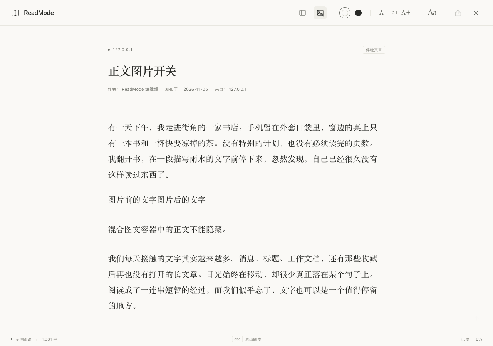

# ReadMode

受 Safari 阅读器启发的 Chrome / Edge 阅读模式插件。黑白皮肤、衬线排版和充足留白，让文章更容易读。

## 安装

1. Chrome 打开 `chrome://extensions`，Edge 打开 `edge://extensions`。
2. 开启「开发者模式」，点击「加载已解压的扩展程序」。
3. 选择本项目文件夹 

使用打包版时，先解压 `dist/ReadMode.zip`，再加载其中的 `ReadMode` 文件夹。建议在浏览器工具栏中固定 ReadMode 图标。

## 使用

- 黑白主题切换，自动保存阅读偏好。
- 纯净、纤维纸、羊皮纸三种纸张质感，纹理强度可以调整，兼容黑白主题。
- 调整字体字号（12–28 px）、行距（1.20–2.60 倍）、段落间距（8–64 px）与内容宽度（280–1000 px），自动保存偏好。
- 选取正文生成分享卡片，支持编辑摘录、黑白配色、下载 PNG 和复制图片，右下角附原文二维码。
- 通过目录跳转章节，查看阅读进度。作者信息按「作者：… 发布于：… 来自：…」分别展示，雪球作者栏会排除隐藏备注、关注按钮并保留发布时间与来源地区。
- 打开一篇文章，连续按两次 `A`（`aa`）进入阅读模式；也可以点击 ReadMode 图标，或按备用快捷键 `Alt+Shift+R`。
- 按 `Esc` 或点击关闭按钮返回原网页。
